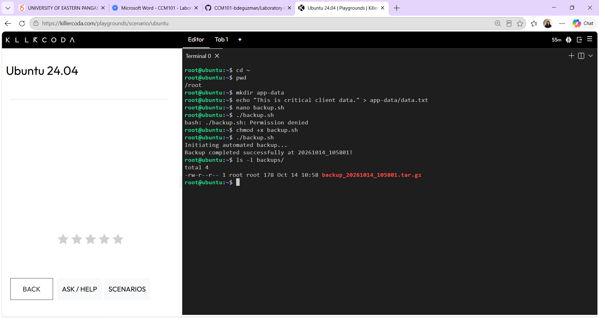
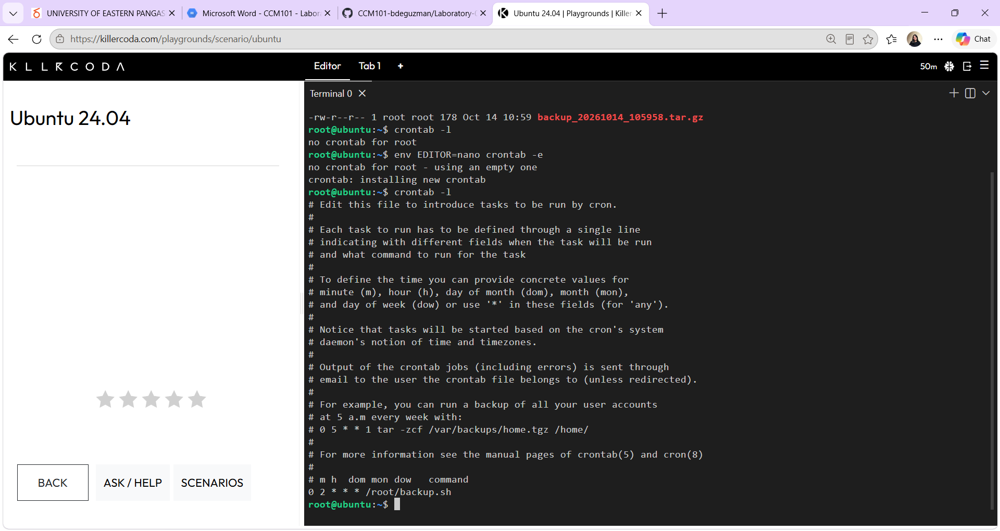

# Backup Script Guide

## The Script (`backup.sh`)

```bash
#!/bin/bash
# Automated Backup Script for CloudNova Technologies

SOURCE_DIR="app-data"
BACKUP_DIR="backups"
TIMESTAMP=$(date +"%Y%m%d_%H%M%S")

echo "Initiating automated backup..."

# Create the backup directory if it does not exist
mkdir -p $BACKUP_DIR

# Compress the source directory into a tarball (.tar.gz)
tar -czf $BACKUP_DIR/backup_$TIMESTAMP.tar.gz $SOURCE_DIR

echo "Backup completed successfully at $TIMESTAMP!"
```

## What `chmod +x` Did
By default, a new file in Linux is only a text file and cannot be run as a program. The command `chmod +x backup.sh` added the **execute (x)** permission to the file, so Linux now allows me to run it with `./backup.sh`.

## The Cron Expression

```
0 2 * * * /root/backup.sh
```

| Field | Value | Meaning |
|-------|-------|---------|
| Minute | `0` | At minute 0 (the start of the hour) |
| Hour | `2` | At 2 AM |
| Day of Month | `*` | Every day of the month |
| Month | `*` | Every month |
| Day of Week | `*` | Every day of the week |

Together, this runs `/root/backup.sh` every night at exactly 2:00 AM.

## Screenshots


